<div align="center">

# TOKENPULSE

**Монитор ИИ-сервера по сети: видеокарта, процессор, температуры и скорость токенов в реальном времени.**

Поставьте агент на компьютер с видеокартой и смотрите на любом другом компьютере в сети:
в отдельном окне, в узкой полоске поверх всех окон или в виджете. Шесть скинов, Windows и Linux.

[](https://github.com/ildargiv/tokenpulse/actions/workflows/build.yml)


[Скачать](#скачать) · [Быстрый старт](#быстрый-старт) · [Скины](#скины) · [Движки](#какие-движки-понимает) · [Настройка агента](#агент-на-сервере)

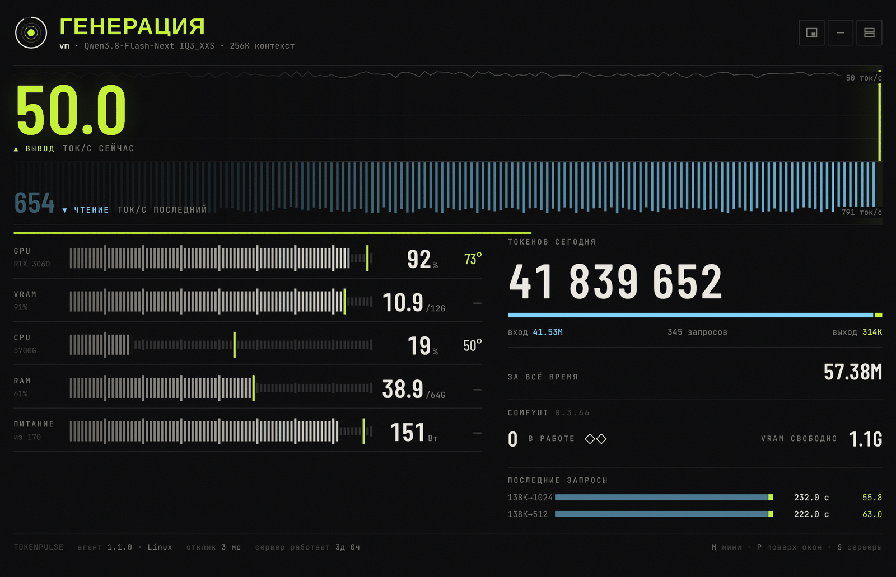

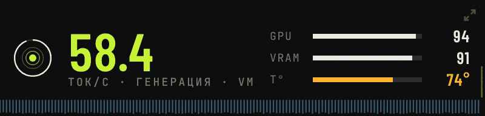

</div>

---

## Что умеет

- **Скорость токенов вживую.** Вывод (декод) и чтение промпта (prefill) отдельно, лента за последние 150 секунд.
- **Железо.** Загрузка и температура GPU и видеопамяти, CPU, RAM, потребляемая мощность с отметкой пика.
- **Счётчик токенов с памятью.** За сегодня и за всё время; переживает перезапуск движка.
- **Понимает движки.** Strata, llama.cpp, vLLM, LM Studio, Ollama, любой OpenAI-совместимый сервер и ComfyUI. Движок находится сам.
- **Компактный режим.** Полоска 364 × 104, мини-окно поверх всех окон, скорость в заголовке и загрузка GPU на иконке, пока окно свёрнуто.
- **Несколько серверов** и переключение в один клик.
- **Шесть скинов:** не перекраска, а разные раскладки для разных людей.
- **Без зависимостей.** Агент работает на стандартной библиотеке Python, а для Windows и Linux есть готовые сборки без Python.
- **Демо-режим выключен по умолчанию.** Монитор сразу подключается к настоящему агенту; тестовые данные включаются только явно (`--demo` или `?demo`).

```
 ┌─────────────────────────────────────────────────────────────────┐
 │  ПК с видеокартой (сервер)               ваш компьютер          │
 │  TokenPulse-Agent ── http://IP:8787 ──▶  монитор / виджет       │
 │  (agent.py)           /api/stats         (окно Edge/Chrome,     │
 │                       веб-страница        TokenPulse-Widget)    │
 └─────────────────────────────────────────────────────────────────┘
```

---

## Скриншоты скинов

Скин переключается клавишей `K` или в панели серверов (`S`), выбор запоминается. Можно задать адресом: `?skin=console`.

| Пульс | Консоль | Спокойный |
|:---:|:---:|:---:|
| 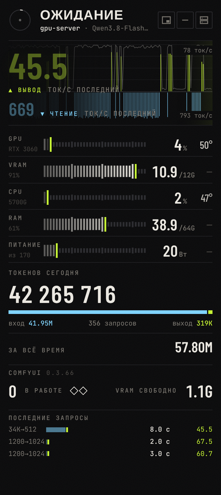 | 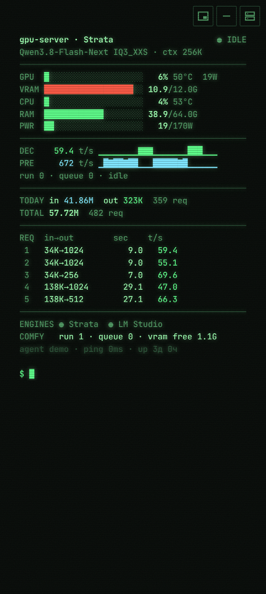 | 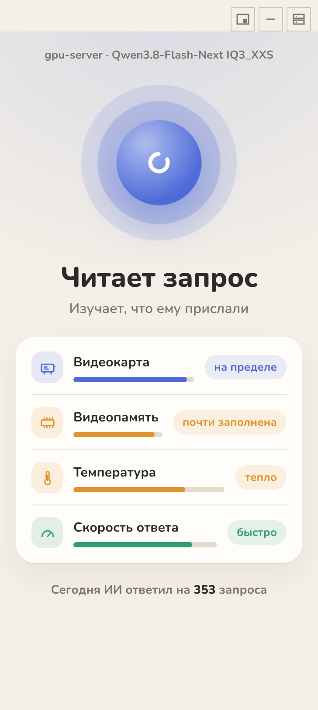 |
| **Приборы** | **Эфир** | **Эбру** |
| 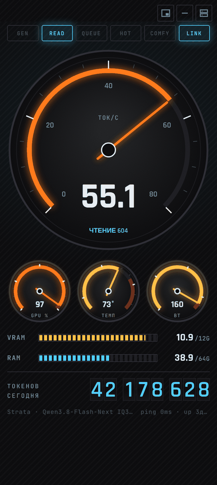 | 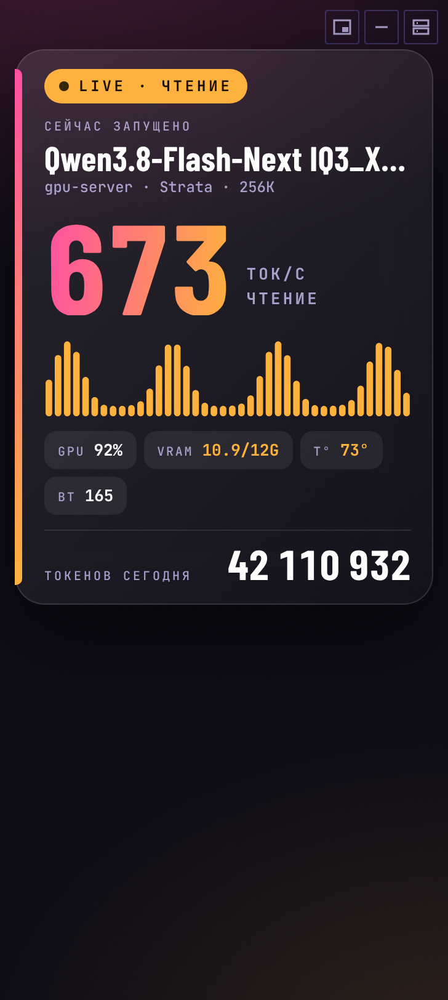 | 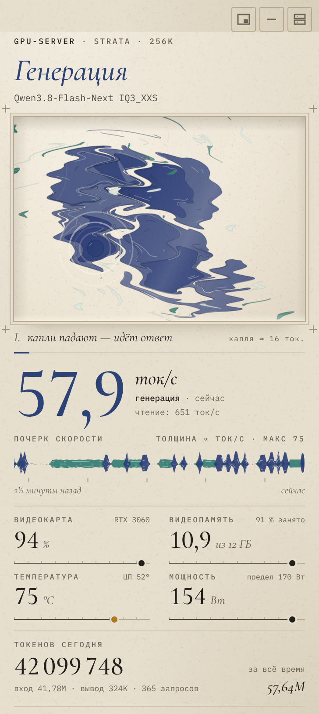 |

<details>
<summary><b>Эбру во весь экран, в простое и без связи</b></summary>

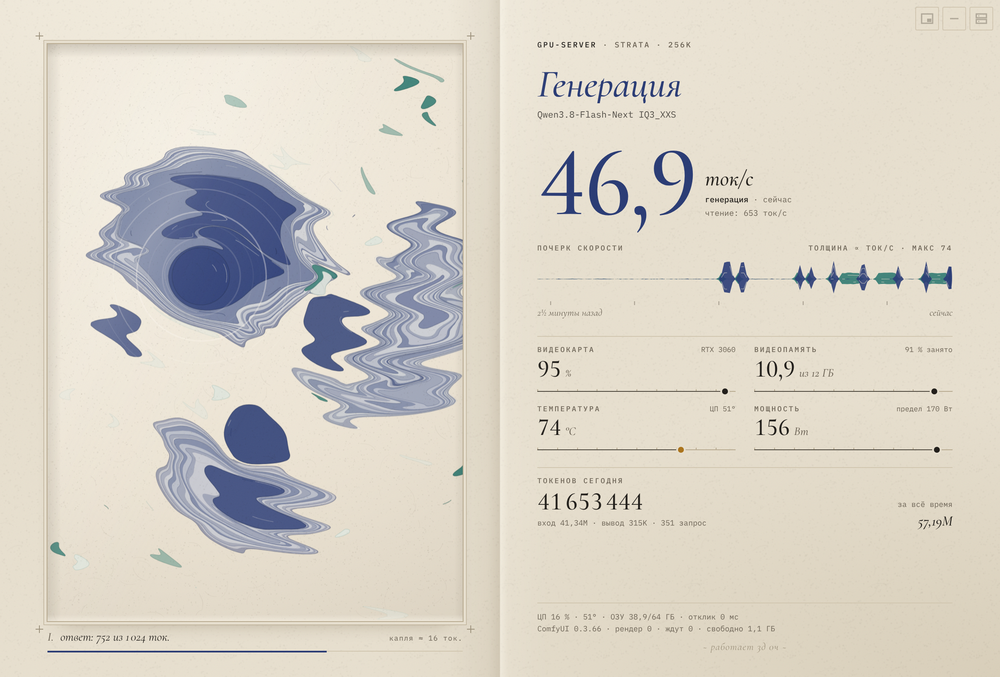

| В простое | Нет связи с агентом |
|:---:|:---:|
| 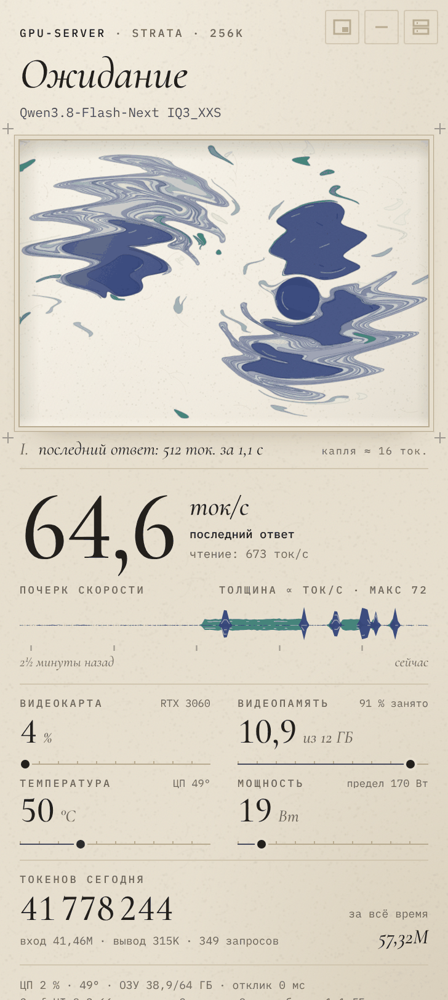 | 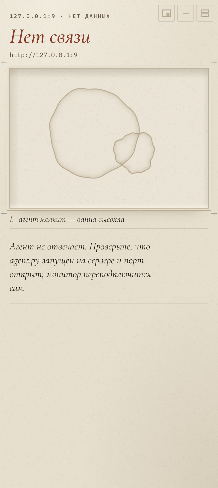 |

</details>

### Скины

| Скин | Для кого | Что внутри |
|---|---|---|
| **Пульс** (`pulse`) | энтузиастам | лента пульса: вывод вверх, чтение вниз, шкалы с пиками, счётчик токенов с прокруткой цифр |
| **Консоль** (`console`) | админам и инженерам | текстовый терминал: все цифры, строки-шкалы, спарклайны, таблица запросов, свечение ЭЛТ |
| **Спокойный** (`calm`) | всем остальным | без терминов: дышащий шар, «Свободен» / «Читает запрос» / «Отвечает», слова вместо цифр |
| **Приборы** (`cockpit`) | геймерам и оверклокерам | аналоговый спидометр ток/с, три малых циферблата, контрольные лампы, топливные шкалы, одометр токенов |
| **Эфир** (`onair`) | стримерам и для записи экрана | плашка как в эфире: LIVE, модель, скорость, эквалайзер под такт токенов. `&bg=none` даёт прозрачный фон для OBS |
| **Эбру** (`aurora`) | витрина | чернила по воде: капля = 16 токенов, гребень = чтение промпта, кривая скорости как мазок кисти |

Скины лежат в `web/skins/`, по одному файлу на скин. Свой скин добавляется одним файлом:
контракт, данные и правила описаны в [web/skins/README.md](web/skins/README.md).

---

## Скачать

Готовые сборки лежат на странице [**Releases**](https://github.com/ildargiv/tokenpulse/releases). Python для них не нужен.

| Система | Файл | Внутри |
|---|---|---|
| **Windows 10/11** | `TokenPulse-windows.zip` | `TokenPulse-Agent.exe`, `TokenPulse-Widget.exe`, `start-monitor.bat`, `start-monitor-frameless.bat` |
| **Linux x86-64** | `TokenPulse-linux-x64.tar.gz` | `TokenPulse-Agent`, `TokenPulse-Widget`, `start-monitor.sh`, `start-widget-web.sh` |

Отдельно к релизу прикреплены `TokenPulse-Agent.exe` и `TokenPulse-Widget.exe`, если нужен только один файл.

> Windows SmartScreen может предупредить о неизвестном издателе: сборки не подписаны.
> Нажмите «Подробнее», затем «Выполнить в любом случае».

Сборки делает GitHub Actions ([`build.yml`](.github/workflows/build.yml)) на Windows и Ubuntu: при пуше тега `v*`
файлы публикуются в релиз, а в каждом пулл-реквесте архивы лежат в разделе Artifacts у сборки.

---

## Быстрый старт

### 1. На сервере (компьютер с видеокартой)

**Windows:** распакуйте `TokenPulse-windows.zip` и запустите `TokenPulse-Agent.exe`.

**Linux:**

```bash
tar xzf TokenPulse-linux-x64.tar.gz && cd TokenPulse-linux-x64
./TokenPulse-Agent
```

**Из исходников** (любая система с Python 3.8+):

```bash
git clone https://github.com/ildargiv/tokenpulse.git && cd tokenpulse
./start-agent.sh          # Windows: start-agent.bat
```

Проверка: откройте `http://IP-сервера:8787/` в браузере.

### 2. На своём компьютере

Монитор со скинами отдельным окном, без вкладок и адресной строки (Edge, Chrome или Chromium):

```bash
start-monitor.bat http://192.168.31.30:8787                 # Windows
./start-monitor.sh http://192.168.31.30:8787                # Linux
./start-monitor.sh http://192.168.31.30:8787 mini           # сразу компактная полоска
./start-monitor.sh http://192.168.31.30:8787 full cockpit   # третий аргумент задаёт скин
```

Или виджет: `TokenPulse-Widget.exe --server http://192.168.31.30:8787` (Linux: `./TokenPulse-Widget --server ...`).
Адрес виджет запоминает, дальше достаточно двойного щелчка.

### Посмотреть без видеокарты (демо)

Демо-режим по умолчанию выключен. Включить его можно явно:

```bash
TokenPulse-Agent.exe --demo        # или python3 agent.py --demo, или TP_DEMO=1
```

Ещё проще открыть `web/index.html?demo` прямо из папки (`&engine=lmstudio` или `&engine=llamacpp`
покажет, как выглядят движки, которые отдают меньше данных). В панели серверов можно добавить адрес `demo`.

---

## Монитор: компактный режим и управление

| Клавиша | Действие |
|---|---|
| `M` или кнопка `—` | свернуть в полоску 364 × 104 и обратно; если окно ниже 170 px, полоска включается сама |
| `P` или кнопка `▣` | мини-окно **поверх всех окон** (Chrome и Edge 116+) |
| `S` | серверы: добавить адрес и токен, переключиться в один клик |
| `K` | следующий скин |
| `Esc` | закрыть панель |

Пока окно свёрнуто на панель задач, скорость и загрузка видны в заголовке окна, а иконка показывает загрузку GPU кольцом.
Список серверов хранится в браузере. Прежняя страница доступна по адресу `/classic.html`.

**Окно без рамки.**
На Windows `start-monitor-frameless.bat` (те же аргументы) убирает заголовок и границу окна через `frameless.py`
(нужен Python). Окно двигается за верхнюю полосу 40 px, закрывается по Alt+F4; вернуть рамку: `python frameless.py --restore`.
На Linux то же делает `start-widget-web.sh` (см. [ниже](#linux)).

---

## Какие движки понимает

Агент сам находит движок на привычных портах (Strata и llama.cpp 8080, LM Studio 1234,
Ollama 11434, vLLM 8000) и определяет, что это. Если работают несколько, на экране тот, что занят
сейчас, а остальные видны в списке движков. Монитор честно показывает, чего движок не отдаёт:

| Движок | Откуда берёт | Что видно | Чего нет |
|---|---|---|---|
| **Strata** | `/metrics` | всё: скорость сейчас, очередь, контекст, история запросов, итоги | |
| **llama.cpp** (`llama-server`) | `/props`, `/slots`, `/metrics` | модель, контекст, занят или нет, очередь, средние скорости, счётчики токенов | живая скорость только если сервер отдаёт прогресс слотов; для токенов и средних запустите с `--metrics` |
| **vLLM** | `/metrics`, `/v1/models` | очередь, живая скорость из счётчиков, заполнение KV-кэша, модель, контекст | история запросов |
| **LM Studio** | `/api/v0/models` | загруженная модель и контекст | скорость и активность: «работает» определяется по загрузке GPU |
| **Ollama** | `/api/ps`, `/api/version` | загруженная модель, занятая VRAM | скорость и активность, как у LM Studio |
| другой с `/v1/models` | `/v1/models` | имя модели | всё остальное |
| **ComfyUI** | `/system_stats`, `/queue` | очередь, свободная VRAM | |

Когда активность определена по загрузке GPU, агент не считает работой то, что делает ComfyUI.
Токены у движков без истории запросов копятся в журнале по приращению счётчиков.

Задать адреса вручную:

```bash
python3 agent.py --engine http://127.0.0.1:1234
python3 agent.py --engine "lmstudio=http://192.168.31.40:1234,ollama=http://127.0.0.1:11434"
ENGINE_URL=http://127.0.0.1:8081 ./start-agent.sh      # тип определится сам
```

---

## Агент на сервере

После запуска доступны:

| Адрес | Что отдаёт |
|---|---|
| `http://IP:8787/` | монитор со скинами |
| `http://IP:8787/api/stats` | все метрики одним JSON |
| `http://IP:8787/api/tokens` | история токенов по дням |
| `http://IP:8787/api/health` | проверка, что агент жив |

Агент слушает `0.0.0.0:8787`, CORS открыт (`*`), по умолчанию без пароля.

Параметры (переменные окружения или аргументы, у exe те же):

```bash
MONITOR_PORT=8787 ENGINE_URL=http://127.0.0.1:8080 COMFY_URL=http://127.0.0.1:8188 ./start-agent.sh
python3 agent.py --port 8787 --engine http://127.0.0.1:8080 --comfy http://127.0.0.1:8188
python3 agent.py --demo          # тестовые данные вместо настоящих (по умолчанию выключено)
```

Что он читает:

- **Видеокарта, её температура и температура видеопамяти** из `nvidia-smi`
- **Температура процессора** на Linux из `/sys/class/hwmon` (`k10temp`, `coretemp`, `zenpower`, `cpu_thermal`), запасной вариант `/sys/class/thermal`; на Windows см. [ниже](#windows)
- **Загрузка CPU и RAM** из `/proc/stat` и `/proc/meminfo` (или `psutil`, если установлен)
- **Движок и ComfyUI**, см. [таблицу выше](#какие-движки-понимает)

### Токен доступа (необязательно)

Если агент виден из сети и хочется закрыть доступ, задайте токен:

```bash
TP_TOKEN=мой-секрет ./start-agent.sh
python3 agent.py --token мой-секрет
# Windows: set TP_TOKEN=мой-секрет, затем start-agent.bat или TokenPulse-Agent.exe --token мой-секрет
```

Тогда `/api/stats` и `/api/tokens` отвечают только клиенту с токеном: заголовок `X-Token`,
`Authorization: Bearer ...` или параметр `?token=...`. `/api/health` и страница остаются открытыми;
страница запомнит токен, если один раз открыть `http://IP:8787/?token=мой-секрет`. В виджете токен вводится в «Настройках».

### Счётчик токенов с памятью

Учёт ведёт агент в файле `~/.tokenpulse/tokens.json`:

```json
{
  "all_time": {"prompt": 56660000, "output": 438901, "reused": 55690000, "requests": 466},
  "days": {"2026-11-06": {"prompt": 41250000, "output": 312116, "reused": 40610000, "requests": 343}}
}
```

- каждый запрос считается один раз (по идентификатору), без двойного счёта;
- `prompt` это входные токены, `output` выходные, `reused` взятые из кэша (уже посчитаны в `prompt`);
- дни хранятся 420 дней, список просмотренных запросов ограничен последними 5000;
- счётчики самого движка обнуляются при его перезапуске, а этот журнал нет;
- первый запуск берёт текущие итоги движка как отправную точку.

---

## Виджет

`TokenPulse-Widget` (или `widget.py`) это вертикальный виджет на Tkinter: кольца загрузки, датчики с цветовой шкалой
температуры, скорость обоих видов токенов, график за 48 секунд, счётчики за день и за всё время, последние запросы.

```bash
python3 widget.py --server http://192.168.31.30:8787
```

Настройки хранятся в `~/.tokenpulse/widget.json`: адрес, позиция окна, режим сворачивания, цель дня и токен API.
Если адрес не указан и агент работает на этом же компьютере, виджет сам запускает агент.

- перетащить за верхнюю строку: переместить окно;
- двойной клик по верхней строке или `▾` / `▴`: свернуть / развернуть;
- правый клик: меню (настройки, поверх всех окон, выход);
- `Esc` сворачивает, `Ctrl+Q` закрывает, `◉` держит поверх всех окон.

---

## Windows

- `TokenPulse-Agent.exe` или `start-agent.bat` запускают агент в окне консоли, `TokenPulse-Widget.exe` или `start-widget.bat` запускают виджет без консоли.
- Температура видеокарты берётся из `nvidia-smi`, он ставится с драйвером NVIDIA.
- Температуру процессора Windows просто так не отдаёт. Варианты:
  1. WMI-датчик `MSAcpi_ThermalZoneTemperature` (агент пробует сам через `powershell`);
  2. **LibreHardwareMonitor** даёт самые точные числа: запустите его и задайте агенту
     `TP_LHM_URL=http://127.0.0.1:8085`, после чего появятся температуры CPU и видеопамяти;
  3. если датчика нет, в строке ПРОЦЕССОР будет прочерк, остальное работает.

## Linux

- Готовая сборка: `TokenPulse-Agent` и `TokenPulse-Widget` из `TokenPulse-linux-x64.tar.gz` (x86-64, glibc 2.35+, например Ubuntu 22.04 и новее).
- Из исходников виджету нужен Tkinter: `sudo apt install python3-tk`.

**Монитор со скинами в окне без рамки** (вместо Tkinter): `widget_web.py` открывает ту же веб-страницу
в отдельном окне поверх остальных, работают все скины и компактный режим.

```bash
sudo apt install python3-gi gir1.2-webkit2-4.0     # один раз

./start-widget-web.sh                              # этот компьютер
./start-widget-web.sh http://192.168.31.30:8787    # агент на другом компьютере
./start-widget-web.sh --skin cockpit               # pulse, console, calm, cockpit, onair, aurora
./start-widget-web.sh --mini                       # сразу компактная полоска
./start-widget-web.sh --no-top --size 520x900      # не держать поверх окон, свой размер
```

Окно тянется за полоску `⠿ TokenPulse` сверху, правый клик по ней сворачивает окно в полосу, `×` или `Esc` закрывают.
Локальный агент запускается сам (`--no-agent` отключает это).

**Автозапуск агента через systemd** (`/etc/systemd/system/tokenpulse.service`):

```ini
[Unit]
Description=TokenPulse agent
After=network-online.target

[Service]
ExecStart=/opt/tokenpulse/TokenPulse-Agent --port 8787
Restart=on-failure
User=ваш-пользователь

[Install]
WantedBy=multi-user.target
```

```bash
sudo systemctl daemon-reload && sudo systemctl enable --now tokenpulse
```

<details>
<summary>Tkinter без root-доступа</summary>

Можно распаковать Tkinter в `~/.local/opt/tk`: `start-widget.sh` сам подставит переменные, если найдёт там библиотеки.

```bash
export PYTHONPATH=$HOME/.local/opt/tk/usr/lib/python3.10:...
export LD_LIBRARY_PATH=$HOME/.local/opt/tk/usr/lib/x86_64-linux-gnu:...
export TK_LIBRARY=$HOME/.local/opt/tk/usr/share/tcltk/tk8.6
# другой префикс: TK_ROOT=/путь/к/usr ./start-widget.sh
```

</details>

---

## Сборка из исходников

```bash
pip install pyinstaller
# Windows
pyinstaller --onefile --console  --name TokenPulse-Agent  --add-data "web;web" agent.py
pyinstaller --onefile --windowed --name TokenPulse-Widget widget.py
# Linux
pyinstaller --onefile --console  --name TokenPulse-Agent  --add-data "web:web" agent.py
pyinstaller --onefile --windowed --name TokenPulse-Widget widget.py
```

Готовые файлы окажутся в `dist/`. Тесты адаптеров на поддельных серверах: `python3 -m unittest discover -s tests -v`.

Выпустить релиз: поставить тег `v*` (например `git tag v0.2.0 && git push origin v0.2.0`), сборка сама прикрепит архивы.

---

## Файлы

| Файл | Что делает |
|---|---|
| `agent.py` | Собирает метрики (GPU, CPU, температуры, движок, ComfyUI) и отдаёт их по HTTP. Только стандартная библиотека Python. |
| `engines.py` | Адаптеры движков: llama.cpp, vLLM, LM Studio, Ollama, OpenAI-совместимые. |
| `widget.py` | Виджет на Tkinter: кольца загрузки, датчики, оба вида токенов, счётчики с памятью. |
| `widget_web.py` / `start-widget-web.sh` | Монитор со скинами в окне без рамки на Linux (GTK + WebKit2). |
| `web/index.html` | Монитор: браузер или отдельное окно, компактный режим, несколько серверов. |
| `web/skins/` | Скины, по одному файлу на скин, и [описание](web/skins/README.md), как сделать свой. |
| `web/classic.html` | Прежняя веб-страница. |
| `start-monitor.bat` / `start-monitor.sh` | Монитор отдельным окном Edge/Chrome. |
| `start-monitor-frameless.bat` / `frameless.py` | То же без рамки окна (Windows). |
| `start-agent.*` / `start-widget.*` | Запуск агента и виджета из исходников. |
| `.github/workflows/build.yml` | Сборка exe для Windows и бинарников для Linux, публикация релиза по тегу. |

## Быстрая проверка, что всё живо

```bash
curl -s http://127.0.0.1:8787/api/health
curl -s http://127.0.0.1:8787/api/stats | python3 -m json.tool | head -40
```

## Лицензия

MIT, см. [LICENSE](LICENSE).
