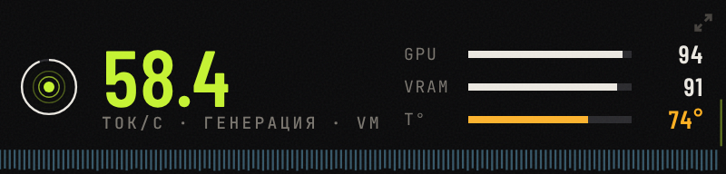

# TOKENPULSE

Маленький вертикальный виджет для рабочего стола, который показывает в реальном времени
загрузку видеокарты и процессора, температуры, память, скорость токенов и постоянный
счётчик токенов (за день и за всё время). Работает по сети: сервер отдаёт метрики,
виджет их рисует. Linux и Windows.

```
 ┌───────────────────────────────────────────────────────────┐
 │  ПК с видеокартой (сервер)          другой компьютер      │
 │  agent.py  ── http://IP:8787/api/stats ──▶  widget.py     │
 │                    └── веб-страница http://IP:8787/       │
 └───────────────────────────────────────────────────────────┘
```

---

## Монитор PULSE (новый интерфейс)


Открывается на любом компьютере в сети по адресу агента `http://IP:8787/`.
Лучше всего запускать его отдельным окном, без вкладок и адресной строки:

```bat
start-monitor.bat http://192.168.31.30:8787
start-monitor.bat http://192.168.31.30:8787 mini
```

На Linux то же самое: `./start-monitor.sh http://192.168.31.30:8787`.
Скрипт ищет Edge или Chrome и открывает монитор как отдельное приложение.

Что на экране:

- **Лента пульса**: скорость за последние 2,5 минуты. Вверх уходят выходные токены (лайм),
  вниз входные, то есть чтение промпта (голубой). Тонкая линия поверх ленты показывает загрузку GPU.
- **Шкалы GPU, VRAM, CPU, RAM, питание** с отметкой пика за последние 8 секунд
  и температурой, которая краснеет по мере нагрева.
- **Счётчик токенов за день** с прокруткой цифр, соотношение вход/выход, итог за всё время.
- **ComfyUI**: задачи в работе и в очереди, свободная VRAM.
- **Последние запросы**: сколько прочитано и сгенерировано, время, скорость.
- Индикатор в углу показывает, что делает сервер: пульсирует при генерации,
  заполняется при чтении промпта, «дышит» в простое и рвётся пунктиром, если нет связи.



Компактный режим:

- кнопка `—` или клавиша `M` сворачивает монитор в узкую полоску;
  если сузить окно, он переходит в этот вид сам;
- кнопка `▣` или клавиша `P` открывает мини-окно **поверх всех окон** (Chrome и Edge 116+);
- пока окно свёрнуто на панель задач, скорость и загрузка видны в заголовке окна,
  а иконка показывает загрузку GPU кольцом.

Несколько серверов: кнопка серверов или клавиша `S`. Там добавляются адрес и токен,
а переключение между серверами занимает один клик. Список хранится в браузере.

Посмотреть без видеокарты: `python3 agent.py --demo`, затем откройте `http://127.0.0.1:8787/`.
Ещё проще открыть `web/index.html?demo` прямо из папки. Прежняя страница доступна по адресу `/classic.html`.

---

## Установка

```bash
git clone https://github.com/ildargiv/tokenpulse.git
cd tokenpulse
```

Нужен только Python 3.8 или новее. Внешние библиотеки не обязательны: агент работает на
стандартной библиотеке, виджету нужен Tkinter (входит в стандартный установщик Python на
Windows; на Linux — пакет `python3-tk`).

---

## Файлы

| Файл | Что делает |
|---|---|
| `agent.py` | Собирает метрики (GPU, CPU, температуры, Strata, ComfyUI) и отдаёт их по HTTP. Только стандартная библиотека Python. |
| `widget.py` | Вертикальный виджет: кольца загрузки, блок датчиков, оба вида токенов, счётчики с памятью. |
| `web/index.html` | Монитор PULSE: браузер или отдельное окно, компактный режим, несколько серверов. |
| `web/classic.html` | Прежняя веб-страница. |
| `start-monitor.bat` / `start-monitor.sh` | Монитор отдельным окном (Edge/Chrome), `mini` сразу открывает компактную полоску. |
| `start-agent.sh` / `start-agent.bat` | Запуск агента (Linux / Windows). |
| `start-widget.sh` / `start-widget.bat` | Запуск виджета (Linux / Windows). |

---

## 1. На сервере (компьютер с видеокартой)

```bash
cd tokenpulse
./start-agent.sh
```

После запуска доступны:

- `http://127.0.0.1:8787/api/stats` — все метрики одним JSON
- `http://127.0.0.1:8787/api/tokens` — история токенов по дням
- `http://127.0.0.1:8787/api/health` — проверка, что агент жив
- `http://127.0.0.1:8787/` — страница мониторинга в браузере

Агент слушает `0.0.0.0:8787`, CORS открыт (`*`), по умолчанию без пароля — данные открытые.
При необходимости доступ можно закрыть токеном (см. ниже).

Настройки запуска (переменные или параметры):

```bash
MONITOR_PORT=8787 STRATA_URL=http://127.0.0.1:8080 COMFY_URL=http://127.0.0.1:8188 ./start-agent.sh
python3 agent.py --port 8787 --strata http://127.0.0.1:8080 --comfy http://127.0.0.1:8188
```

Что он читает:

- **Видеокарта, её температура и температура видеопамяти (HBM)** — из `nvidia-smi`
- **Температура процессора** — из `/sys/class/hwmon` (`k10temp`, `coretemp`, `zenpower`, `cpu_thermal`), запасной вариант — `/sys/class/thermal`
- **Загрузка CPU и RAM** — из `/proc/stat`, `/proc/meminfo` (или `psutil`, если установлен)
- **Strata** — `/metrics` (скорость, очередь, контекст, история запросов, итоги)
- **ComfyUI** — `/system_stats` и `/queue`

### Токен доступа (необязательно)

По умолчанию API открыт. Если компьютер с агентом доступен из сети и хочется закрыть
доступ паролем, задайте токен при запуске:

```bash
TP_TOKEN=мой-секрет ./start-agent.sh
# или
python3 agent.py --token мой-секрет
```

Тогда `/api/stats` и `/api/tokens` отвечают только клиенту, который прислал токен одним
из способов:

- заголовок `X-Token: мой-секрет`
- заголовок `Authorization: Bearer мой-секрет`
- параметр `?token=мой-секрет`

`/api/health` и веб-страница остаются открытыми; страница запомнит токен, если открыть её
один раз как `http://IP:8787/?token=мой-секрет`. В виджете токен вводится в «Настройках».
Без `TP_TOKEN` всё работает как раньше, без пароля.

Windows: задайте токен перед запуском — `set TP_TOKEN=мой-секрет`, затем `start-agent.bat`.

## 2. На втором компьютере (виджет)

Нужен Python 3.8 или новее (на Windows обычный установщик с python.org — Tkinter уже входит).

```bash
python3 widget.py --server http://192.168.31.30:8787
```

Windows: `start-widget.bat --server http://192.168.31.30:8787`
или `pythonw widget.py --server http://192.168.31.30:8787`

Адрес сервера виджет запоминает в `~/.tokenpulse/widget.json` и дальше стартует сам.
Там же хранятся позиция окна, режим сворачивания, цель дня и токен API.

Если адрес не указан и агент работает на этом же компьютере, виджет сам запускает `agent.py`.

### Управление виджетом

- Перетащить за верхнюю строку — переместить окно
- Двойной клик по верхней строке или кнопка `▾` / `▴` — свернуть / развернуть
- Правый клик — меню: настройки, поверх всех окон, выход
- `Esc` — свернуть, `Ctrl+Q` — выйти
- Поверх всех окон — кнопка `◉`

### Что видно в свёрнутом режиме

Два мини-кольца (видеокарта, процессор), скорость ДЕКОД и PREFILL,
температуры и сумма токенов за день.

## 3. Что показывает виджет

- **Кольца:** загрузка видеокарты, загрузка процессора, потребляемая мощность (Вт из лимита)
- **Датчики (по порядку: видеокарта → видеопамять → процессор → оперативная память):**
  полоса загрузки, числовое значение и полоса температуры с цветовой шкалой
  (зелёный → жёлтый → красный)
- **Скорость обоих видов токенов:** ДЕКОД (выходные токены, ↑) и PREFILL (входные токены, ↓).
  Когда движок работает — живые значения, когда простаивает — среднее за прогон
- **График истории:** реальные ток/с по секундам за последние 48 секунд; ноль = простой
- **Счётчики токенов:** сегодня и за всё время, отдельно ВХОД и ВЫХОД, округлённые до
  сотых долей миллиона (`56.66M`), точные значения подписаны отдельной строкой
- **Последние запросы:** входные и выходные токены + обе скорости
- **Статус:** Strata, ComfyUI, хост, задержка ответа

---

## Счётчик токенов с памятью

Учёт ведёт агент в файле `~/.tokenpulse/tokens.json`:

```json
{
  "all_time": {"prompt": 56660000, "output": 438901, "reused": 55690000, "requests": 466},
  "days": {"2026-11-06": {"prompt": 41250000, "output": 312116, "reused": 40610000, "requests": 343}}
}
```

- Каждый запрос считается один раз (по идентификатору запроса), поэтому нет двойного счёта
- `prompt` — входные токены, `output` — выходные, `reused` — токены, взятые из кэша (они
  уже посчитаны в `prompt`)
- Дни хранятся до 420 дней, список просмотренных запросов — последние 5000
- `/metrics` самого Strata обнуляется при перезапуске движка, а этот журнал — нет
- Первый запуск берёт текущие итоги движка как отправную точку

История по дням: `http://127.0.0.1:8787/api/tokens`

---

## Windows

- `start-agent.bat` — агент в окне консоли, `start-widget.bat` — виджет без окна
- Температура видеокарты берётся из `nvidia-smi` (он ставится с драйвером NVIDIA)
- Температуры процессора Windows не отдаёт просто так. Варианты:
  1. WMI-датчик `MSAcpi_ThermalZoneTemperature` (агент пробует сам, через `powershell`)
  2. **LibreHardwareMonitor** — самые точные числа: запустите его и у агента задайте
     переменную окружения `TP_LHM_URL=http://127.0.0.1:8085`,
     после чего в датчиках появится подписанная температура CPU и видеопамяти
  3. Если датчика нет — в строке ПРОЦЕССОР будет прочерк, остальное работает

## Если нет tkinter на Linux

Если системного `python3-tk` нет, а ставить пакет с root-доступом не хочется, можно
распаковать Tkinter в `~/.local/opt/tk` — `start-widget.sh` сам подставит переменные,
если найдёт там библиотеки:

```bash
export PYTHONPATH=$HOME/.local/opt/tk/usr/lib/python3.10:...
export LD_LIBRARY_PATH=$HOME/.local/opt/tk/usr/lib/x86_64-linux-gnu:...
export TK_LIBRARY=$HOME/.local/opt/tk/usr/share/tcltk/tk8.6
# другой префикс: TK_ROOT=/путь/к/usr ./start-widget.sh
```

Если есть root-доступ, достаточно `sudo apt install python3-tk`.

## Лицензия

MIT — см. [LICENSE](LICENSE).

## Быстрая проверка, что всё живо

```bash
curl -s http://127.0.0.1:8787/api/health
curl -s http://127.0.0.1:8787/api/stats | python3 -m json.tool | head -40
```

Что должно быть в JSON: `cpu.temp_c`, `gpu.temp`, `gpu.temp_mem`, `temps`,
`strata.decode_tok_s_avg`, `strata.prefill_tok_s_avg`, `tokens.today`, `tokens.all_time`.
